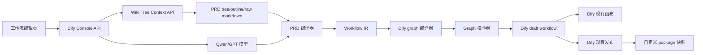

# PRD 到工作流生成技术设计

状态：草稿
最后更新：2026-07-07

## 技术决策

第一版在 Dify 内实现，复用 Dify 现有工作流能力。新增代码聚焦在 PRD 上下文获取、PRD 编译、Dify graph 生成、package 快照生成和自然语言 graph patch。

不重建画布和 workflow runtime。Dify 仍然是执行平台。PRD 编译器的代码边界要尽量清晰，后续可以抽成独立服务，Dify 只是其中一个目标平台 adapter。

## 现有 Dify 复用点

前端：

- 工作流画布：`web/app/components/workflow/`
- 现有工作流生成器 UI：`web/app/components/workflow/workflow-generator/`
- 工作流生成器接口封装：`web/service/debug.ts`
- 发布查询和 mutation hooks：`web/service/use-workflow.ts`
- DSL 导入导出封装：`web/service/apps.ts`

后端：

- 现有生成器 controller：`api/controllers/console/app/generator.py`
- 现有生成器 service：`api/services/workflow_generator_service.py`
- 现有生成器 core：`api/core/workflow/generator/`
- Draft workflow API：`api/controllers/console/app/workflow.py`
- Draft sync service：`api/services/workflow_service.py`
- Publish flow：`api/controllers/console/app/workflow.py` 和 `api/services/workflow_service.py`
- DSL 导入导出：`api/services/app_dsl_service.py` 和 `api/controllers/console/app/app_import.py`

相关现有接口：

- `POST /console/api/workflow-generate`
- `POST /console/api/workflow-generate/stream`
- `POST /console/api/apps/{app_id}/workflows/draft`
- `GET /console/api/apps/{app_id}/workflows/draft`
- `POST /console/api/apps/{app_id}/workflows/publish`
- `GET /console/api/apps/{app_id}/workflows/publish`
- `GET /console/api/apps/{app_id}/export?workflow_id={workflow_id}`

## 目标架构



## 后端模块设计

### Controller 层

在现有 generator 相关接口附近增加 PRD 专用接口。

建议文件：

```text
api/controllers/console/app/generator.py
```

如果 controller 继续变大，可以拆成：

```text
api/controllers/console/app/prd_workflow_generator.py
```

建议接口：

```http
POST /console/api/workflow-generate/from-prd
POST /console/api/workflow-generate/from-prd/stream
POST /console/api/apps/{app_id}/workflows/{workflow_id}/package/export
POST /console/api/apps/{app_id}/workflows/draft/nl-edit
```

MVP 可只实现阻塞式 `from-prd` 接口。

### Service 层

建议新增文件：

```text
api/services/prd_context_service.py
api/services/prd_workflow_generator_service.py
api/services/workflow_package_service.py
api/services/workflow_graph_edit_service.py
```

职责：

- `PrdContextService`：调用外部 Wiki Tree Context API，并标准化响应。
- `PrdWorkflowGeneratorService`：编排上下文获取、LLM 编译、graph 生成、校验和 draft sync。
- `WorkflowPackageService`：构建、存储和下载 package 快照。
- `WorkflowGraphEditService`：将自然语言修改转换成经过校验的 graph patch。

### Core 领域层

建议目录：

```text
api/core/workflow/prd_compiler/
```

建议文件：

```text
entities.py
wiki_context.py
planner.py
dify_compiler.py
validator.py
graph_patch.py
package_builder.py
prompts/
```

职责：

- 定义平台无关的 PRD workflow IR。
- 将 wiki tree context 转成 LLM prompt 输入。
- 使用 LLM 生成结构化 IR。
- 将 IR 编译成 Dify graph。
- 在 draft sync 前校验 Dify graph。
- 将 published workflow 和编译产物转换成 package。
- 为自然语言编辑生成 graph patch。

## API 设计

### 从 PRD 生成工作流

```http
POST /console/api/workflow-generate/from-prd
```

请求：

```json
{
  "app_id": "uuid",
  "source": {
    "type": "wiki_tree_context",
    "doc_id": "wiki-meta::category::name_hash",
    "workspace": "ws_xxx",
    "tree_type": "reasoning_action",
    "force_rebuild": false
  },
  "mode": "workflow",
  "model_config": {
    "provider": "langgenius/tongyi/tongyi",
    "name": "qwen-plus",
    "mode": "chat",
    "completion_params": {}
  },
  "sync_to_draft": true,
  "overwrite_policy": "require_confirmation"
}
```

成功响应：

```json
{
  "result": "success",
  "draft_synced": true,
  "workflow": {
    "id": "draft_workflow_id",
    "hash": "draft_hash"
  },
  "graph": {
    "nodes": [],
    "edges": [],
    "viewport": { "x": 0, "y": 0, "zoom": 0.7 }
  },
  "ir": {},
  "warnings": [],
  "missing_requirements": [],
  "source": {
    "doc_id": "wiki-meta::category::name_hash",
    "version": 3,
    "source_name": "..."
  }
}
```

校验失败响应：

```json
{
  "result": "error",
  "code": "GRAPH_VALIDATION_FAILED",
  "errors": [
    { "path": "nodes[2].data", "message": "LLM 节点缺少 prompt template" }
  ],
  "draft_synced": false
}
```

### 自然语言编辑

```http
POST /console/api/apps/{app_id}/workflows/draft/nl-edit
```

请求：

```json
{
  "instruction": "在 opportunity-scoring 后增加人工确认节点",
  "selected_node_id": "opportunity-scoring",
  "scope": "selected_node_and_neighbors",
  "dry_run": true
}
```

响应：

```json
{
  "patch": {
    "operations": []
  },
  "preview_graph": {},
  "warnings": [],
  "requires_confirmation": true
}
```

第一版应返回预览，并要求用户再次确认后应用，或者由前端在用户确认后再调用 apply。

### Package 导出

```http
POST /console/api/apps/{app_id}/workflows/{workflow_id}/package/export
```

响应形式可选：

- 返回 JSON 元数据和下载 URL。
- 直接返回 zip archive stream。
- 返回已存储 artifact id。

MVP 可以根据部署环境选择返回 zip stream 或本地 artifact metadata。

## Wiki Tree Context API 集成

外部接口返回结构化 PRD 上下文：

- `tree_json`：递归节点树。
- `outline_md`：Markdown 大纲。
- `raw_bundle.markdown`：可选，原始 Markdown。
- `dimension_bundle.markdown`：可选，维度表 Markdown。

集成规则：

- 必须传 `LIGHTRAG-WORKSPACE`。
- `tree_type` 默认 `reasoning_action`。
- `force_rebuild` 默认 `false`。
- 外部请求必须配置 timeout 和错误处理。
- 响应可能达到数百 KB，进入 LLM 前需要裁剪、摘要或分段。
- 保留 `doc_id`、`source_name`、`version`、`tree_type`，用于 package 溯源。
- 文档和 package 文件统一使用 UTF-8 编码。

## 中间表示 IR

不要让 LLM 直接把最终 Dify graph 作为唯一事实来源。PRD context 和 Dify graph 中间需要一层 workflow IR。

建议 IR：

```json
{
  "id": "workflow-id",
  "title": "工作流标题",
  "scenario": "业务场景",
  "inputs": [
    { "name": "query", "type": "string", "required": true }
  ],
  "outputs": [
    { "name": "answer", "type": "string" }
  ],
  "phases": [
    {
      "id": "demand-clarification",
      "title": "需求澄清",
      "kind": "llm_task",
      "goal": "明确目标市场、类目边界和输出目标",
      "inputs": ["query"],
      "outputs": ["brief"],
      "confirmation": "after_phase",
      "depends_on": []
    }
  ],
  "edges": [
    { "source": "start", "target": "demand-clarification" }
  ],
  "schemas": [],
  "skills": []
}
```

使用 IR 的收益：

- 更容易校验。
- 更容易生成 package。
- 更容易扩展未来 Coze adapter。
- 更容易支持自然语言 patch。

## Dify Graph 编译

初始 IR 到 Dify 节点映射：

| IR 类型 | Dify 节点 |
|---|---|
| `workflow_start` | `start` |
| `llm_task` | `llm` |
| `condition` | `if-else` |
| `knowledge_lookup` | `knowledge-retrieval` |
| `http_call` | `http-request` |
| `code_transform` | `code` |
| `human_confirmation` | `human-input` 或现有可支持的审批模式 |
| `workflow_output` | `answer` 或 `end` |

编译器必须生成：

- node id。
- 节点坐标。
- node data payload。
- edges。
- variable selectors。
- output mappings。
- graph viewport。

兼容性参考应优先看 `api/core/workflow/generator` 的输出 shape，因为现有注释说明它生成的 graph 可直接被 `WorkflowService.sync_draft_workflow` 消费。

## Graph 校验

draft sync 前必须校验 graph。

最低校验项：

- graph 有且只有一个 start 节点。
- graph 有终止节点或 answer 节点。
- node id 唯一。
- 每条 edge 的 source 和 target 都存在。
- 节点类型被当前 Dify 版本支持。
- 必填字段完整。
- variable selector 引用上游已存在输出。
- 条件分支连线完整。
- graph 和 package 中不嵌入 secret 明文。

校验失败必须阻止覆盖 draft。

## Draft Sync 策略

有两种实现方式：

1. 后端直接调用 `WorkflowService.sync_draft_workflow` 写入生成 graph。
2. 后端返回 graph，前端调用现有 draft sync。

MVP 推荐方式：后端校验通过后直接写入 draft，然后前端刷新 draft。这样可以减少前端处理 graph shape 的复杂度，并保持编译操作原子化。

保护措施：

- 如果当前 draft hash 不一致，要求用户确认。
- 如果前端有未保存本地变更，生成前必须提示。
- 尽量保留旧 draft 可恢复路径，复用 Dify 已有历史能力。

## Package 快照设计

自定义 package 是一个与 published workflow 关联的可移植、可审计制品。它不是 Dify 运行时本身。Dify 仍然运行数据库里的 published workflow。

导出的 package 必须严格遵循用户给定的参考格式，不允许在 MVP 中扩展额外顶层目录或文件。唯一允许的顶层结构是：

```text
package.yaml
workflow.yaml
skills/
schemas/
data/
```

Dify graph、IR、validation、source metadata、Dify DSL 等数据只用于内部生成、校验、写入 draft 和追踪，不进入用户下载的 package。后续如需扩展 package 标准，必须先升级 package schema，再更新导出器。

### package.yaml

字段严格对齐参考 package：

```yaml
id: generated-workflow-id
version: 0.1.0
title: 工作流标题
scenario: 业务场景
entry_workflow: workflow.yaml
```

### workflow.yaml

遵循 `wig-opportunity-discovery` 示例风格：

```yaml
id: generated-workflow-id
entry_phase: demand-clarification
phases:
  - id: demand-clarification
    title: 需求澄清
    skill: demand-clarifier
    goal: 明确目标市场、类目边界、精准词和输出目标
    confirmation: after_phase
```

### skills

每个 phase 生成一个 skill 文件：

```text
skills/<skill-id>/skill.md
```

Front matter 建议包含：

- `name`
- `description`
- `model`
- `tools`
- `output_schema`
- `context_policy`

### schemas

阶段输出使用 JSON Schema。示例里的 `brief.schema.json` 是可参考模式：包含 required 字段、结构化输出、missing input 列表和 evidence ids。

### 不进入 package 的内部数据

以下数据可以在请求生命周期内用于生成和校验，但不写入下载 package：

- Dify graph。
- Dify DSL。
- IR。
- validation 结果。
- source metadata。
- 完整原始 PRD。
- 完整 LLM prompt。

## 发布集成

现有发布流程会创建 published workflow 记录，并更新 `apps.workflow_id`。

package 生成应发生在发布成功之后，但 MVP 不长期保存 package artifact。用户需要 package 时，系统按需生成 zip 下载文件。

已确认策略：

1. 发布流程只生成 Dify published workflow，不强制生成和保存 package。
2. 用户点击导出 package 时，后端基于 published workflow 和内部编译上下文按需生成严格格式 zip。
3. 生成完成后直接下载，不落库、不写对象存储。
4. Dify DSL 不进入 package；Dify graph、IR、validation 等内部数据也不进入 package。

潜在接入点：

- 保持 `WorkflowService.publish_workflow` 主流程不变。
- 新增 package export endpoint，根据 `workflow_id` 读取 published workflow 并生成下载 zip。

## 右侧自然语言编辑器

前端：

- 在工作流编辑页增加右侧助手面板。
- 支持选中节点上下文和全局 workflow 上下文。
- 展示 proposed changes 后再允许应用。

后端：

- 使用当前 draft graph 作为输入。
- 使用独立 graph patch prompt，不复用现有从零生成 workflow 的 prompt。
- 让 LLM 输出类型化 graph patch，尽量不要每次返回完整替换 graph。
- 对 patch 后的 graph 做校验。
- 返回 preview graph 和 warnings。

Patch 操作示例：

```json
[
  { "op": "add_node", "node": {} },
  { "op": "update_node", "node_id": "x", "changes": {} },
  { "op": "add_edge", "edge": {} },
  { "op": "remove_edge", "edge_id": "x" }
]
```

禁止未校验地接受 LLM 任意输出作为最终 graph。

## 安全和隐私

- 不把真实凭证导出到 package。
- 使用 secret placeholder 和 dependency declaration。
- 获取 PRD 上下文和修改 draft 前必须做 workspace/tenant 权限检查。
- 校验外部 `doc_id` 和 workspace header。
- MVP 避免任意 URL 拉取，降低 SSRF 风险。
- compile artifacts 默认不保存完整原始 PRD 和完整 LLM prompt。
- 默认只保存 source metadata、IR、Dify graph、validation 结果和必要摘要。
- 如需保存更多原始 PRD 片段，必须由企业数据规则明确授权。
- 默认日志只记录生成元数据，不记录敏感 PRD 正文。

## 测试策略

后端单元测试：

- Wiki Tree Context 响应标准化。
- IR 校验。
- IR 到 Dify graph 编译。
- graph 校验失败。
- package builder 输出结构。
- 自然语言 patch 校验。

Controller 测试：

- 成功从 PRD 生成 workflow。
- 外部 API 错误。
- LLM 错误。
- graph 校验错误。
- draft hash 冲突。
- 发布后 package export。

前端测试：

- PRD 面板表单校验。
- 生成进度状态。
- 错误展示。
- 生成成功后刷新 draft。
- 自然语言编辑的预览、应用和拒绝。

人工验收：

- 使用已知 Wiki PRD 生成简单 workflow。
- 打开画布检查节点。
- 执行 draft debug。
- 发布。
- 通过 Dify 现有运行时调用 published workflow。
- 导出 package 并检查必要文件。

## 分阶段落地计划

### 阶段 1：Dify Draft 生成 MVP

- 只支持 Wiki PRD 来源。
- 只做阻塞式生成接口。
- 只支持 Start、LLM、IfElse、Answer/End。
- 后端 graph 校验。
- 后端写入 draft。
- 前端刷新画布。

### 阶段 2：丰富节点和 package

- 支持 Knowledge Retrieval、HTTP Request、Code、Tool、Human Input、Trigger 节点映射。
- 将 package 中的 `confirmation` 语义映射到 Human Input 或 Dify 支持的人工确认模式。
- 支持按需导出 package 下载文件。
- 支持 package 下载。
- 增加生成日志。

### 阶段 3：自然语言编辑

- 增加右侧助手。
- 支持选中节点上下文。
- 返回 graph patch 预览。
- 用户确认后应用 patch 并校验。

### 阶段 4：编译器抽离

- 将 PRD compiler 移到独立服务或独立包。
- Dify 保持为 adapter target。
- 只有 Dify 路径稳定后，再增加其他目标平台 adapter。

## 已确认技术决策

- package artifact 只生成下载文件，不长期保存。
- 导出的 package 必须严格按照给定 package 格式生成，只包含 `package.yaml`、`workflow.yaml`、`skills/`、`schemas/`、`data/`。
- Dify DSL、Dify graph、IR、validation、source metadata 等内部数据不进入 package。
- MVP 节点类型只支持 Start、LLM、IfElse、Answer/End。
- 第二阶段再支持 Knowledge Retrieval、HTTP Request、Code、Tool、Human Input、Trigger。
- 第一版人工确认只保留在 package `confirmation` 字段和 IR 中，不强行映射到 Dify graph；第二阶段支持 Human Input 后再映射。
- 右侧助手使用独立 graph patch prompt。
- compile artifacts 默认不保存完整 PRD 原文和完整 LLM prompt，只保存 source metadata、IR、graph、validation 和必要摘要。
